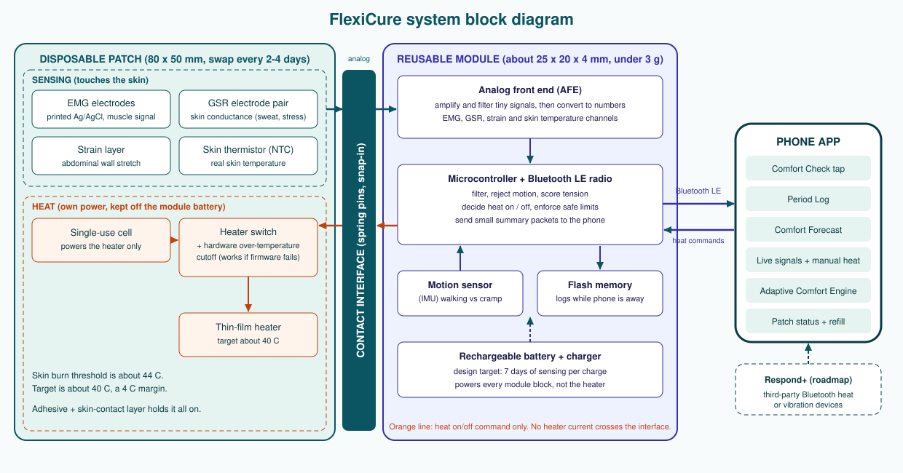
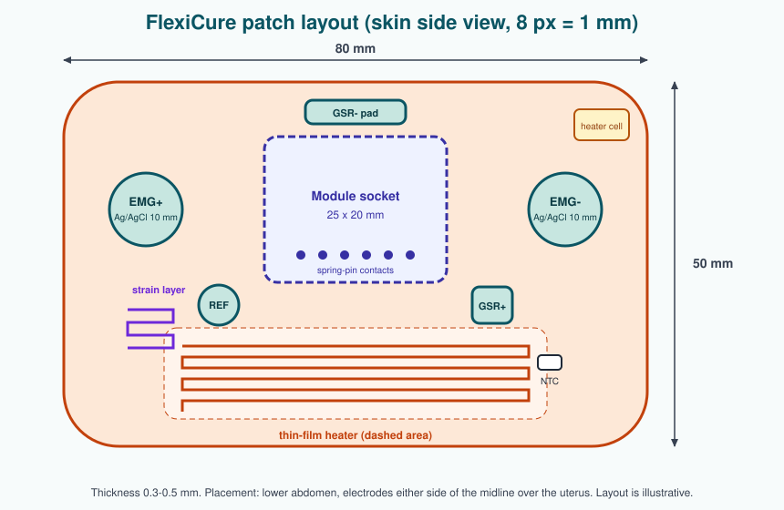
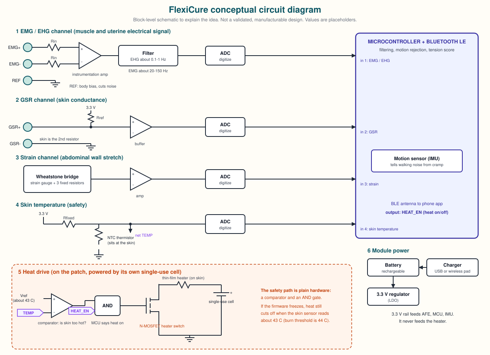
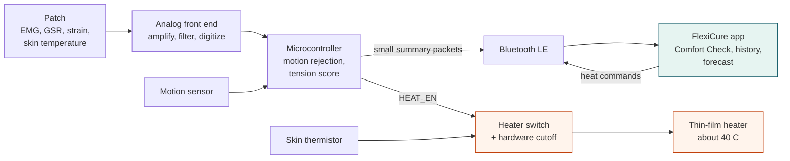
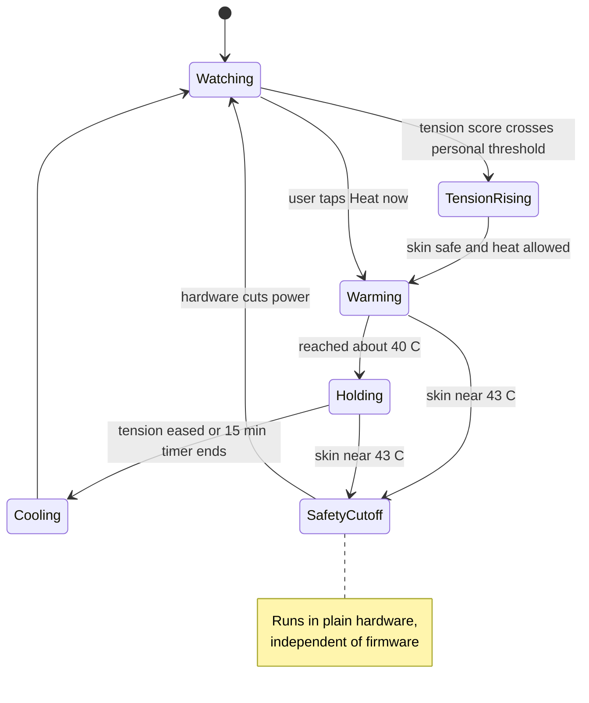
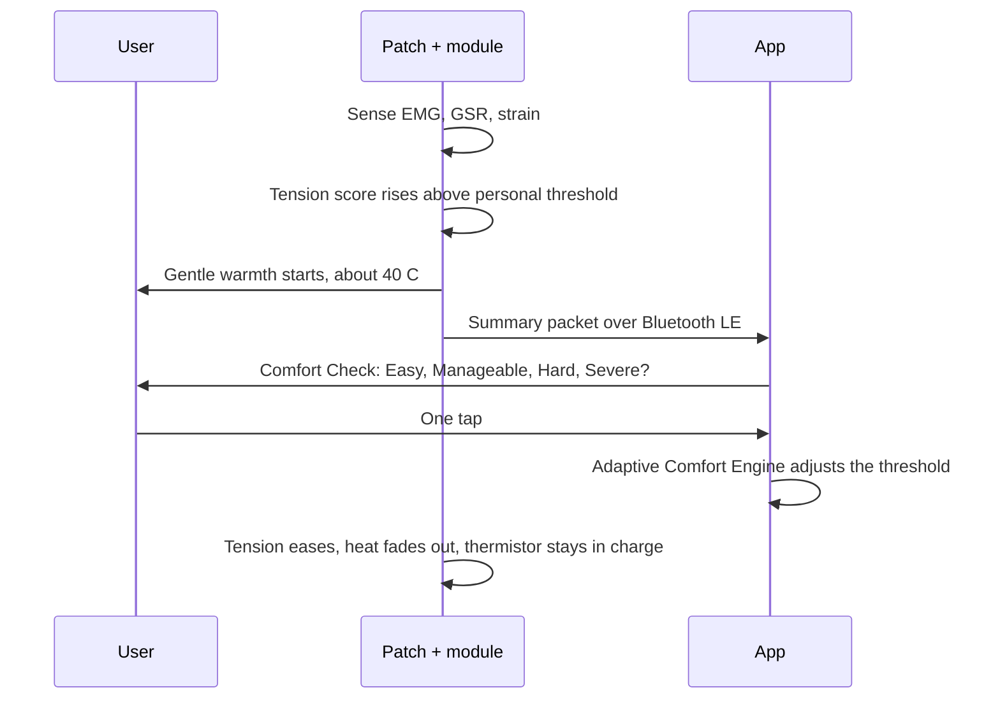

# FlexiCure

### Sense the tension. Warm it before it wins.

A non-insertable, two-part wearable that reads abdominal muscle tension and responds with gentle, safe heat.

   

**Team FLEXICURE** &nbsp;|&nbsp; Oulu, Finland &nbsp;|&nbsp; Concept stage: nothing here is bench-tested or clinically validated yet

---

## Why it exists

Menstrual cramping and everyday abdominal muscle tension are managed by guesswork: a heat wrap or a painkiller applied on a hunch, with no signal for when tension is building or whether the fix helped. Existing wearables that do sense something (Elvie, Perifit) are insertable and built for pelvic-floor exercise, a different muscle group and a different job.

FlexiCure is the missing middle: **a sensing wearable that sits on the skin, not inside the body, and acts on what it senses.**

## At a glance

| | |
| --- | --- |
| **Worn on** | Lower abdomen, over the uterus |
| **Senses** | Muscle electrical activity (EMG), skin conductance (GSR), abdominal stretch (strain), skin temperature |
| **Responds with** | Heat at about 40 C, automatic or on demand |
| **Learns from** | One-tap Comfort Check: Easy / Manageable / Hard / Severe |
| **Hardware** | Reusable electronics module + disposable patch |
| **Model** | Razor and blades: module sold once, patches repeatedly |
| **Not** | Insertable, a diagnostic device, or a TENS (electrical stimulation) device |

---

## 1. System block diagram

**Why two parts?** Sensing is cheap in energy (roughly 150-200 microwatts, or about 25-34 mWh per week). One 10-15 minute heat session needs 0.5-1 W, which is roughly 60-190 mWh. A single heat session can use more energy than a whole week of sensing. So the heater runs from its own single-use cell in the patch, and the module battery is spent only on sensing and Bluetooth. That is what makes a 7-day charge a believable target instead of a claim that breaks the first time someone uses heat. These are estimates, not measurements.

## 2. The patch

| Property | Design target |
| --- | --- |
| Size | 80 x 50 mm, 0.3-0.5 mm thick |
| Life | Replaced every 2-4 days |
| Electrodes | Printed Ag/AgCl (silver / silver chloride) |
| Heater | Thin-film resistive heater, target about 40 C |
| Own power | Single-use cell for the heater only |
| Cost target (COGS, cost of goods sold) | EUR 2-3.50 per patch |

The module is about 25 x 20 x 4 mm and under 3 g, rechargeable, and clicks into the socket through spring pins.

## 3. Sensors explained

| Sensor | What it measures | Why we use it | Honest limitation |
| --- | --- | --- | --- |
| **EMG** (electromyography) | Tiny electrical signals from contracting muscle, picked up by two skin electrodes and a reference | Shows when the abdominal muscles tense up. Over the uterus the same method is called electrohysterography (EHG), used clinically to monitor uterine contractions | Signal is microvolts and noisy. Link to cramp severity is not yet validated |
| **GSR** (galvanic skin response) | How well skin conducts electricity, which rises with sweat | Pain and stress change sweat activity, so it adds a second opinion beside EMG | Also changes with heat, exercise, and weather |
| **Strain** | Stretch of the abdominal wall, from a printed strain layer | Tension and bloating change how the skin stretches. Helps confirm that a muscle signal is a real contraction | Posture and clothing add movement |
| **Skin thermistor** (NTC, a resistor whose value changes with temperature) | Real skin temperature under the patch | Safety: lets the hardware cut heat before the skin gets near the 44 C burn threshold | Must sit at the skin, not at the module base |
| **Motion sensor** (IMU, inertial measurement unit) | Walking, turning, coughing | Separates body movement from cramp signal | Design addition, still to be validated |

Evidence behind the sensing: EHG detected about 94% of contractions versus about 54% for tocodynamometry in a 2026 study (*Sensors* 2026, 26(15), 4669). A 43 x 36 mm abdominal EMG patch (Jo et al. 2018) shows the form factor is feasible.

## 4. Conceptual circuit diagram

Reading it: each sensor gets its own small signal chain (amplify, filter, digitize) into the microcontroller. The heater is separate. A comparator watches skin temperature and an AND gate only lets the heater switch turn on when the microcontroller asks **and** the skin is safe, so the safety path does not depend on firmware. This is a teaching schematic with placeholder values, not a manufacturable design.

### Candidate parts (not selected, not validated)

| Job | Candidate | Note |
| --- | --- | --- |
| Biopotential analog front end | Texas Instruments ADS1292R | Low-power two-channel biopotential chip. Check channel count against our needs |
| Microcontroller + Bluetooth LE | Nordic nRF52840 | Common wearable choice, also has NFC for tap pairing |
| Motion sensor | Any low-power 3-axis accelerometer | Pick on current draw |

## 5. How the data flows

Processing happens on the module, and only small processed summaries go to the phone. Streaming raw signals over Bluetooth would drain a small battery quickly.

## 6. The control loop

## 7. A cramp episode, step by step

## 8. The app

| Feature | What it does |
| --- | --- |
| **Comfort Check** | One tap: Easy, Manageable, Hard, Severe. No forms |
| **Period Log** | Cycle and period tracking, tied to comfort history |
| **Comfort Forecast** | Suggests warmth before tension peaks, from the user's own pattern |
| **Adaptive Comfort Engine** | Personalises heat thresholds from the taps. Unvalidated, to be tested in a pilot |
| **Live signals** | EMG, GSR and strain trace, plus manual heat control |
| **Patch status** | Contact quality, wear time, refill reminder |
| **Respond+** (roadmap) | Connects to third-party Bluetooth heat or vibration devices. FlexiCure builds in no electrical stimulation, because TENS (transcutaneous electrical nerve stimulation) is a regulated device in the US (FDA Class II) |

## 9. Heat: how much and how safe

- Target about **40 C**. Skin burn threshold is about **44 C**, so the margin is about 4 C.
- Hardware cutoff at about 43 C, independent of software.
- Evidence for heat: Machado et al. 2019, a placebo-controlled trial with 88 participants and 4 arms. Thermotherapy beat TENS (p=0.01) and placebo (p=0.05). Outcomes were NRS (numeric rating scale), Br-MPQ (Brazilian McGill pain questionnaire), PPT (pressure pain threshold) and CPM (conditioned pain modulation).

## 10. Business model

| Item | Planning estimate |
| --- | --- |
| Module COGS | EUR 8-14 |
| Patch COGS | EUR 2-3.50 |
| Proposed module price | EUR 39-49 (not locked) |
| Patch 3-pack subscription | About EUR 15 per month |
| Margins | Module 64-84%, patch 30-60% |
| Market | Pelvic-floor device market USD 892.4M in 2026 to USD 1.89B in 2035, 8.7% CAGR (MarkWide, third-party estimate) |
| Comparable devices | Elvie EUR 149-199, Perifit EUR 99-149 |

Precedent for the reusable-electronics plus disposable-sensor split: Dexcom G6. Dexcom later integrated both parts in the G7 because users found the two-piece design fiddly. Our module swap happens every 2-4 days, not every 90, which is a bet we have not tested. See the Q&A sheet, question 20.

## 11. Repository map

| Path | Contents |
| --- | --- |
| [`docs/case-study.md`](docs/case-study.md) | Full case study and technical report (Markdown) |
| [`docs/FlexiCure_Case_Study.docx`](docs/FlexiCure_Case_Study.docx) | Same report as a Word file, 13 pages |
| [`slides/FlexiCure_Deck.pptx`](slides/FlexiCure_Deck.pptx) | 13-slide pitch deck with speaker notes |
| [`slides/deck-text.md`](slides/deck-text.md) | Deck text and notes, readable on GitHub |
| [`docs/pitch-script.md`](docs/pitch-script.md) | 3-minute and 1-minute pitch scripts |
| [`docs/qa-prep-sheet.md`](docs/qa-prep-sheet.md) | 20 hard judge questions with honest answers |
| [`docs/images/`](docs/images) | Block diagram, circuit diagram, patch layout (SVG and PNG) |
| [`research/references.md`](research/references.md) | Verified sources and what each supports |
| [`research/open-questions.md`](research/open-questions.md) | Unresolved engineering and business questions |

## 12. Limitations

- The 7-day battery life is a design target. It has not been bench-engineered.
- The Adaptive Comfort Engine and the link between surface EMG/EHG and cramp severity are unvalidated.
- Adhesive wear, skin irritation, heater thermal safety, and the module-to-patch connector are untested.
- Prices are planning estimates. No supplier quotes exist.
- No IP filed. No regulatory strategy done. FlexiCure is framed as a wellness device, not a diagnostic one.
- Diagrams are illustrative, not engineering drawings.

## Glossary

**AFE** analog front end, the chip that reads tiny body signals. **BLE** Bluetooth Low Energy. **COGS** cost of goods sold. **EHG** electrohysterography, EMG over the uterus. **EMG** electromyography, muscle electrical activity. **GSR** galvanic skin response, skin conductance. **IMU** inertial measurement unit, a motion sensor. **LDO** low-dropout regulator, a simple voltage regulator. **NTC** negative temperature coefficient thermistor. **NSAID** non-steroidal anti-inflammatory drug, for example ibuprofen. **TENS** transcutaneous electrical nerve stimulation. The case study has the full glossary.

## License

No license chosen yet. Until one is added, all rights are reserved by the authors. Add a `LICENSE` file before making the repo public if you want others to reuse it.
